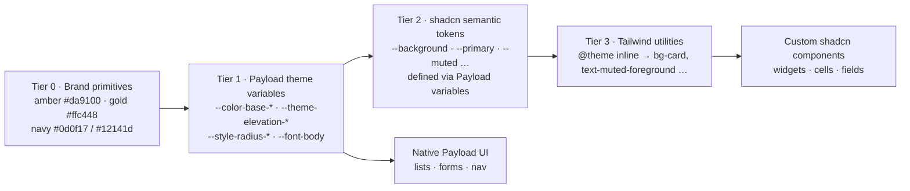
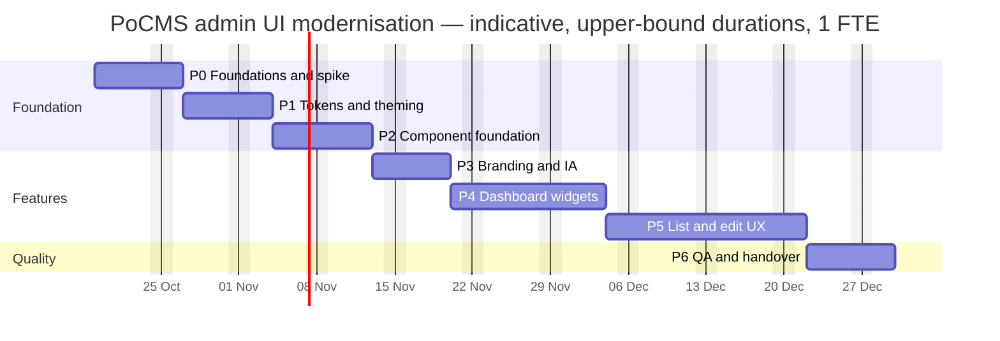

# PoCMS Admin UI Modernization — shadcn/ui × Payload CMS

**Technical analysis · shadcnstudio standards · AdminCN template · integration roadmap**

> **Status:** analysis only — nothing has been implemented. Further technical planning or development waits for explicit approval.

| Item | Value |
|---|---|
| Date | 2026-10-15 |
| Baseline analysed | `dev` @ `0d7dde1` — Payload 3.90.2 · Next.js 16.3.8 · React 19.2.6 · TypeScript 5.7.3 |
| Working branch | `arena/1e75852c-pocms-payload` (fixed for this session — see §13) |
| Reference template | [`shadcnstudio/shadcn-nextjs-admincn-admin-template-free`](https://github.com/shadcnstudio/shadcn-nextjs-admincn-admin-template-free) @ `dd1afd2` (2026-08-18), MIT |
| Live reference | [AdminCN Free — /dashboard/orders](https://shadcn-nextjs-admincn-admin-template-free.vercel.app/dashboard/orders) |
| Organisation surveyed | [github.com/orgs/shadcnstudio](https://github.com/orgs/shadcnstudio/repositories) (25 public repositories) |

## Contents

1. [Executive summary](#1-executive-summary)
2. [Scope, inputs and method](#2-scope-inputs-and-method)
3. [Current state of the PoCMS admin](#3-current-state-of-the-pocms-admin)
4. [shadcnstudio organisation: patterns and standards](#4-shadcnstudio-organisation-patterns-and-standards)
5. [AdminCN template: deep analysis](#5-admincn-template-deep-analysis)
6. [Live dashboard evaluation: /dashboard/orders](#6-live-dashboard-evaluation-dashboardorders)
7. [Payload admin capabilities (verified)](#7-payload-admin-capabilities-verified)
8. [Integration strategy and recommendations](#8-integration-strategy-and-recommendations)
9. [Phased development roadmap](#9-phased-development-roadmap)
10. [Required skills, frameworks and tools](#10-required-skills-frameworks-and-tools)
11. [Decisions required](#11-decisions-required)
12. [Risks and mitigations](#12-risks-and-mitigations)
13. [Delivery workflow notes](#13-delivery-workflow-notes)
- [Appendix A: Evidence index](#appendix-a-evidence-index)
- [Appendix B: Token bridge sketch (not implemented)](#appendix-b-token-bridge-sketch-not-implemented)
- [Appendix C: Sources](#appendix-c-sources)

---

## 1. Executive summary

**Recommendation:** keep Payload's admin as the application shell. Bring in AdminCN's *design language* — design tokens, card/KPI/table anatomy, chart styling and interaction polish — through Payload's own extension points. **Do not port the AdminCN application** (its router, sidebar, header or state), and do not replace Payload's navigation or core views.

Why this integration model is right:

- **Payload already has the slots the AdminCN look needs.**
  - Payload 3.90.2 ships a native *modular dashboard* (`admin.dashboard.widgets`): per-user drag-and-drop layouts saved in preferences, and config fields per widget.
  - It also offers custom list cells, custom field components, nav/header/settings slots and branding graphics.
  - Its CSS uses cascade layers, and every colour, radius and font is a CSS variable.
- **Payload 4 is arriving now.**
  - `4.0.0-beta.1` was published on 2026-10-13. `3.91.0` is the stable release as of today.
  - v4 rebuilds the admin around semantic CSS tokens, drops Sass, ships its own isolated reset (derived from Tailwind's) and redesigns the sidebar.
  - Work tied to Payload 3's internal class names or nav markup will be thrown away. Work built as **tokens + self-contained components** carries over, and the plan is shaped around that.

Key findings:

| # | Finding | Consequence |
|---|---|---|
| 1 | The PoCMS admin is completely stock: no branding, no `admin.group`s (11 collections + 1 global in one flat list), an empty `custom.scss`, the default dashboard and no custom components. | Large, low-risk gains from configuration-level work alone. |
| 2 | Brand amber `#da9100` has **2.61:1** contrast on white. That fails WCAG AA for text *and* the 3:1 minimum for UI components. Its hue is also only about 11° from Payload's warning colour. | Each theme needs its own primary token (`#996600` light, `#da9100` dark), plus a decision on the warning hue. |
| 3 | Tailwind is only safe in Payload 3 with five measures: no Preflight; a `data-theme` dark variant; restricted class scanning; blocking the `table` utility (Payload's list view relies on a `.table` class); and a rebased scale, because the admin's root font size is 13px. | A dedicated isolation spike in Phase 0. All of these rules live in one stylesheet. |
| 4 | AdminCN is an excellent *visual* reference, but it has engineering and accessibility defects: a namespace icon import, a client-only shell, the same alt text on every avatar, status and trend shown without colour semantics, and unformatted currency. | Adopt its patterns rather than copying its code verbatim; quality gates in every phase. |
| 5 | Many declared UI dependencies are unused today: 6 × Radix, lucide-react, next-themes, sonner, clsx, tailwind-merge, react-hook-form, 5 Payload plugins and more. | Audit dependencies before adding new ones. |

**Roadmap:** seven phases (P0–P6), each one shippable on its own behind green CI. Estimated at about 35–52 working days for one senior engineer, or about 5–7 weeks with two. The roadmap is in §9, skills/frameworks/tools in §10, and the eight decisions to confirm in §11.

---

## 2. Scope, inputs and method

**In scope:** the Payload admin (`/admin`, route group `src/app/(payload)`), its configuration, and the collection/global admin settings that shape the editor experience.

**Out of scope:** the public frontend (`src/app/(frontend)`, Bootstrap), except where it shares dependencies or configuration with the admin.

| Input | How it was analysed |
|---|---|
| PoCMS `dev` @ `0d7dde1` | Read `payload.config.ts`, all collections/globals/fields, the `(payload)` route group, styles, tests, tooling, Docker files and docs. |
| shadcnstudio organisation | Listed all 25 repos via the GitHub API. Shallow-cloned 10 (AdminCN plus 9 guides/setups) and compared their `components.json`, `package.json`, CSS and structure. |
| AdminCN template | Shallow clone (269 files): layouts, providers, nav config, dashboard views, data tables, users app, UI primitives, lint/format config, README/CHANGELOG. |
| Live `/dashboard/orders` | Fetched the rendered content of the deployment, plus the official light/dark screenshots published in `shadcnstudio/ss-assets`. |
| Payload 3.90.2 | Inspected the published npm tarballs of `payload`, `@payloadcms/ui` and `@payloadcms/next`: type definitions, the modular-dashboard implementation, compiled CSS/SCSS. **Every Payload API statement in this report was checked against these packages.** |
| Payload 4.0.0-beta.1 | Inspected the `payload` and `@payloadcms/ui` beta tarballs (CSS token files, dashboard API), plus the official v4 preview post and a community migration tracker. |

**Limitations:**

- The PoCMS admin was not run, because the analysis sandbox has no database or secrets.
- The live demo was assessed from its rendered content, source code and screenshots, not by using it hands-on.
- v4 is still in beta, so details may change.

---

## 3. Current state of the PoCMS admin

### 3.1 Snapshot

| Aspect | State on `dev` |
|---|---|
| Payload | 3.90.2 (all `@payloadcms/*` pinned) · Lexical · `vercelPostgresAdapter` · Vercel Blob (media) · Resend email · GraphQL (introspection off in production) |
| Admin config | Only `user`, `livePreview.breakpoints` (375/768/1440) and `importMap.baseDir`. Live preview has no `url` or `collections`, so it is inactive. |
| Custom admin code | None. `custom.scss` is empty, and the import map contains only `CollectionCards` and the Blob client upload handler. |
| Content model | 11 collections (About, Articles, Certificates, Educations, Experiences, Header, Media, Projects, Services, Skills, Users) + 1 global (Footer) |
| Styling | Frontend: Bootstrap 5.3 + FontAwesome + bootstrap-icons; brand tokens in `(frontend)/styles/main.css`. No Tailwind anywhere. |
| Tests | Vitest (integration) + Playwright e2e. The e2e tests rely on stock admin markup: `span[title="Dashboard"]`, `#field-email`, `#field-password`, the "Users" `h1`, `input[name="email"]`. |

### 3.2 Findings

Severity: **H** = blocks the quality goals or creates risk · **M** = notable UX debt · **L** = hygiene.

| ID | Area | Finding | Evidence | Sev |
|---|---|---|---|---|
| F1 | Design consistency | No branding at all: no `admin.meta`, no Logo/Icon, no theme overrides. The admin looks like any other Payload install and has no visual link to the amber-on-navy portfolio brand. | `src/payload.config.ts`, `src/app/(payload)/custom.scss` | H |
| F2 | Design consistency / a11y | The brand palette (`#da9100`, `#ffc448`, `#0d0f17`, `#12141d`) exists only on the frontend. Amber on white is 2.61:1, so it cannot be used as a text or UI colour in a light theme. | `src/app/(frontend)/styles/main.css` | H |
| F3 | Information architecture | Flat navigation: no collection sets `admin.group`. About and Header are single-document content (singletons) but are modelled as collections. | `src/collections/*.ts` | M |
| F4 | Dashboard | Only the default collection cards. No KPIs, recent activity, quick actions or content-health signals. | `src/app/(payload)/admin/importMap.js` | M |
| F5 | Edit UX | Two image inputs per document — an upload *and* a URL text field (`image` + `imageUrl`/`src`) — on Articles, Projects and Certificates, and URL-only images on Header and About. No conditional logic or guidance tells editors which to use. | collection configs | M |
| F6 | Edit UX | Bootstrap/FontAwesome implementation details are exposed as raw selects or text fields: `Skills.color`, `Services.iconFont`, Footer `iconName`/`className`. Editors pick class names blind. | `Skills.ts`, `Services.ts`, `globals/Footer.ts` | M |
| F7 | List UX | Ordering uses a shared numeric `order` field instead of drag-and-drop. | `src/fields/order.ts` | M |
| F8 | Media | Media has only a required `alt` field: no `imageSizes`, `focalPoint`, `adminThumbnail` or `mimeTypes`, even though the docs claim them. List thumbnails and crops suffer as a result. | `src/collections/Media.ts` | M |
| F9 | Workflow | No drafts or versions. Live preview is configured but inactive. | `payload.config.ts` | M |
| F10 | Access | Users has no custom fields at all — no role, name or avatar — even though the docs claim RBAC. Dashboards and nav therefore cannot adapt to roles. | `src/collections/Users.ts` | M |
| F11 | Testing | The e2e selectors are tied to stock markup, so replacing the dashboard view would break the login helper. | `tests/helpers/login.ts`, `tests/e2e/admin.e2e.spec.ts` | M |
| F12 | Hygiene | Orphan files: `src/globals/SiteSettings.ts` (0 B) and `src/globals/Navigation` (0 B, no extension). | `src/globals/` | L |
| F13 | Hygiene | The ESLint config defines `ignores` twice in one object, duplicates rule blocks, and loads both the FlatCompat and the native flat Next configs. | `eslint.config.mjs` | L |
| F14 | Hygiene | Unused dependencies (nothing in `src/` or `tests/` imports them): `@radix-ui/*` ×6, `lucide-react`, `next-themes`, `sonner`, `clsx`, `tailwind-merge`, `react-hook-form`, `embla-carousel-react`, `embla-carousel-auto-scroll`, `prism-react-renderer`, `@apollo/client`, `jsonwebtoken`, `qs-esm`, a direct `date-fns`, `@payloadcms/db-postgres` (the Vercel adapter is used instead), `@payloadcms/live-preview-react`, `@payloadcms/admin-bar`, five Payload plugins (form-builder, nested-docs, redirects, search, seo) and `next-sitemap` (no config). | `package.json` | L |
| F15 | Docs / environment | Configuration has drifted in several places: <ul><li>The docs use `DATABASE_URI`/`PAYLOAD_PUBLIC_SERVER_URL`, but the code uses `POSTGRES_URL`/`NEXT_PUBLIC_SITE_URL`.</li><li>`.env.example` is git-ignored and missing.</li><li>`docker-compose.yml` still runs MongoDB, but the project uses Postgres.</li><li>The Node version differs: 20 in compose, 22 in the Dockerfile.</li><li>The project-structure doc lists directories that don't exist.</li></ul> | `docs/`, `.gitignore`, `docker-compose.yml`, `Dockerfile` | L |

### 3.3 Strengths to preserve

- A small, clean Payload config that is easy to extend, with all `@payloadcms/*` packages pinned together.
- Seed scripts for every content type (`src/seed/*`), which give realistic data for dashboard widgets and visual tests.
- `@testing-library/react` and `jsdom` are already installed, so component tests need no new infrastructure.
- Media `alt` is already required, so accessible thumbnails come for free.
- Centralised revalidation hooks (`revalidateTag('portfolio')`) that new workflows such as drafts and ordering can reuse.

---

## 4. shadcnstudio organisation: patterns and standards

### 4.1 Repository landscape

| Category | Repositories | Relevance to PoCMS |
|---|---|---|
| Flagship | `shadcn-studio` (~1.95k★): components, blocks, templates, theme generator, shadcn registry | Source of the `@ss-*` registry blocks (statistics, charts, widgets) |
| Admin template | `shadcn-nextjs-admincn-admin-template-free` (129★) | Primary design reference |
| Guides / masterclasses | `shadcn-dark-mode-guide`, `nextjs-dynamic-shadcn-themes`, `shadcn-tanstack-table-masterclass`, `shadcn-tanstack-form-masterclass`, `shadcn-forms-masterclass`, `shadcn-cmdk-search`, `shadcn-nextjs-16-setup`, `shadcn-monorepo-setup` | Reference patterns for tokens, theming, tables, forms, ⌘K and project setup |
| Demos / landing pages | `tanstack-dashboard-demo`, `shadcn-{nextjs,astro}-*-landing-page-free` | Examples of registry configuration |
| Tooling | `shadcn-ide-extension`, `shadcn-mcp-server`, `ss-assets` (CDN), `vercel-ai-sdk-shadcn-chat` | IDE and AI-assisted workflows |
| Other platforms | `shadcn-react-native-app`, `shadcn_flutter_app` | Not relevant |

### 4.2 Standards observed across repositories

| Standard | Evidence | Implication for PoCMS |
|---|---|---|
| **Switch from Radix to Base UI primitives during 2026** | <ul><li>Base UI styles: `style: "base-vega"` (AdminCN, monorepo `ui`) and `"base-nova"` (dark-mode, themes, table and Next 16 setup repos, Aug 2026).</li><li>Radix: `"new-york"` in the Feb 2026 repos (cmdk, forms).</li></ul> | Choose Base UI so current org code can be reused as-is (D1) |
| **Tailwind v4, configured in CSS** | `@import "tailwindcss"`, `@theme inline`, `@custom-variant dark (&:is(.dark *))`, `tw-animate-css`, `shadcn/tailwind.css`; no `tailwind.config` | The admin needs a split import without Preflight and a `data-theme` dark variant |
| **OKLCH semantic tokens** | `--background … --ring`, `--chart-1..5`, `--sidebar-*`; radius scale built from multiples of `--radius` (0.625rem) | Map them onto Payload variables so there is one source of truth |
| **Extra semantic tokens** | The dark-mode guide adds `--warning`/`--warning-foreground` with a matching `@theme` entry | Add `--success`/`--warning`/`--info` the same way |
| **Brand-tinted primary** | The dark-mode guide uses an amber primary (oklch 0.555 0.163 49) on a stone base | Precedent for a darker amber in light mode |
| **Runtime theme presets** | Dynamic-themes repo: settings context + cookie, and a preset list that includes shadow, spacing and letter-spacing | Optional later; Payload already persists the theme preference |
| **Component anatomy** | `cva` variants + `cn()` (clsx + tailwind-merge) + `data-slot` attributes; sizes set via `data-size` | Adopt unchanged |
| **Namespaced registries** | `@shadcn-studio`, `@ss-components`, `@ss-blocks`, `@ss-pages`, `@ss-themes` (URLs containing `{style}`) | Pull blocks in through the CLI instead of copy-pasting |
| **Shared UI package** | Monorepo `@workspace/ui` with an `exports` map (`./components/*`, `./lib/*`, `./globals.css`) | Optional: move the admin UI into an internal package later |
| **Icons** | lucide (named imports) | Keep lucide; never use a namespace import |
| **Tooling** | pnpm, Prettier + `prettier-plugin-tailwindcss`, ESLint 9 flat config (+ `@stylistic`), `AGENTS.md` (Next.js agent rules) | Add the Tailwind Prettier plugin and an `AGENTS.md` with admin-UI rules |
| **Version drift to manage** | TanStack Table v9 (`useTable`, `tableFeatures`, `table.FlexRender`) in the masterclass vs v8.21 in AdminCN; zod 3 vs 4 | Pin versions deliberately; never mix major versions |

---

## 5. AdminCN template: deep analysis

### 5.1 Stack

| Area | Packages |
|---|---|
| Framework | Next 16.2.6 · React 19.2.4 · Tailwind 4 (`@tailwindcss/postcss`) |
| Component system | shadcn CLI 4.13 (`base-vega`, RSC, neutral base, CSS variables, lucide, `menuAccent: subtle`) · `@base-ui/react` 1.6 · cva · tw-animate-css · lucide 1.24 |
| Data, forms and UI libraries | TanStack Table 8.21 · Recharts 3.8 · cmdk · nuqs 2.9 · RHF 7.81 + zod 3.25 · react-resizable-panels · sonner 2 |
| Licence | MIT (an attribution link is requested) |

### 5.2 Architecture

```text
app/layout.tsx       NuqsAdapter → Providers (next-themes "class", system) → TooltipProvider → SidebarProvider
├─ (pages)/layout.tsx   'use client' — Sidebar + SidebarInset { Header, <main max-w-360>, Toaster, Footer }
│    └─ route page.tsx (thin) → src/views/<feature>/* (composition) → src/components/ui/* (primitives)
└─ (blank)/layout.tsx   auth and error pages without the shell
configs/navConfig.tsx (typed nav tree, icons by name) · fake-db/* · hooks/* · app/server/actions.ts
```

**Patterns worth adopting**

1. **Thin route → view module → primitives.** This maps 1:1 onto *Payload config path → widget/field module → UI primitives*.
2. **Typed, config-driven navigation**, using discriminated unions to tell a single link apart from a group.
3. **Card anatomy:**
   - `ring-1 ring-foreground/10` and `rounded-xl`;
   - a `--card-spacing` variable with a `data-size="sm"` variant;
   - `data-slot` hooks so parents can style children (`*:data-[slot=card-content]:space-y-5`).
4. **Single-hue, brand-driven charts.** Series colours are `var(--primary)` plus `color-mix(in oklab, var(--primary) 60% | 20% | 10%, transparent)`, so charts follow the brand and work in both themes.
5. **Controlled, server-ready tables.** `manualPagination`/`manualSorting`/`manualFiltering` with an external state hook (users app) — the same model as Payload's server-side list queries.
6. **Accessible forms:** RHF + zod + `Field`/`FieldLabel`/`FieldError`, with `aria-invalid` and `data-invalid`.
7. **Icon-rail flyouts** that keep nested items reachable when the sidebar is collapsed. This only matters if a custom nav is ever built.

### 5.3 Issues and anti-patterns not to carry over

| # | Issue | Evidence | What to do instead in Payload |
|---|---|---|---|
| A1 | A namespace import pulls in every lucide icon, which defeats tree-shaking | `components/layout/Sidebar.tsx:13`: `import * as Icon from 'lucide-react'` | Named imports or a typed icon map |
| A2 | The whole shell is a client component; 83 of 171 `.tsx` files are client modules | `app/(pages)/layout.tsx` starts with `'use client'` | RSC widgets and cells; client islands only where interaction is needed |
| A3 | Upsell nav items are fetched at runtime from a third-party CDN | `app/api/nav-apps/route.ts`, `useEffect` in Sidebar | No runtime third-party calls in the admin |
| A4 | Demo data is hard-coded in route files and `fake-db` | `dashboard/orders/page.tsx` (25 rows inline) | Payload Local API with `req` (access-controlled) |
| A5 | Every avatar has the same alt text | `alt='Hallie Richards'` in `datatable-transaction.tsx` (visible on the live page) | Alt text from data, or `alt=""` when the image is decorative |
| A6 | Status is shown as text only, with one badge style for paid, pending and failed | Transaction table status column | Semantic status tokens + icon + text |
| A7 | Trend deltas don't say whether a change is good or bad: "−8.7% damaged returns" is good news but looks the same as bad news | `statistics-card-01.tsx` | `trend` + `polarity` props → success/destructive tokens, an arrow icon and screen-reader text |
| A8 | Numbers are formatted inconsistently ("$24650" next to "$84,325") | `widget-total-earning.tsx` renders `${earning}` | `Intl.NumberFormat` with the admin locale |
| A9 | Sortable headers are a `div` with `tabIndex` instead of a `<button>` with `aria-sort` | `views/apps/users/list/user-table.tsx` | A button inside `th` plus `aria-sort` |
| A10 | The icon button's label doesn't match its menu ("Edit item" opens Edit/Duplicate/Delete) | `RowActions` in `datatable-transaction.tsx` | "Row actions for {name}" |
| A11 | Breadcrumbs are derived from URL segments, and `BreadcrumbLink` has no `href` | `components/layout/Header.tsx` | Payload `useStepNav`/`SetStepNav` |
| A12 | `` is used 10 times, `next/image` never, and the lint rule is switched off | `eslint.config.mjs`: `@next/next/no-img-element: off` | Payload `Thumbnail` or `next/image` |
| A13 | A third-party `<script>` is injected inside a client component | `Header.tsx` (buttons.github.io) | Not needed |
| A14 | `TooltipProvider` is mounted twice | `app/layout.tsx` and `components/Providers.tsx` | One provider |
| A15 | Empty bars are faked with a placeholder value (`sales: 0.0001`) | `chart-sales-metrics.tsx` | Explicit empty states |
| A16 | Brand logos have low contrast in dark mode (the Bitbank logo on a dark chip) | Official dark screenshot | Light/dark asset variants or a neutral chip |
| A17 | Copy errors ("Sandy' Company") | `chart-sales-metrics.tsx` | Copy review |

---

## 6. Live dashboard evaluation: /dashboard/orders

### 6.1 Layout anatomy

The page is a responsive grid (`grid-cols-2 lg:grid-cols-3 gap-6`) inside a `max-w-360` main area:

1. **KPI row:** three statistic cards, each with an icon chip, value, title and a "than last week" delta.
2. **Left column:** *Product insight* (image plus two mini bar charts) and *Total earning* (value, trend and a progress list).
3. **Sales metrics** (`xl:col-span-2`): entity header, four mini-metric cards, a revenue-goal donut and a segmented "sales plan" bar.
4. **Full-width transactions table:**
   - 5 rows per page;
   - columns: customer (avatar + email), amount, status badge, payment brand, row actions;
   - a footer reading "Showing 1 to 5 of 25 entries" in an `aria-live` region.

**Shell:**
- The header holds a sidebar toggle, breadcrumbs, a theme toggle, a language menu and a profile menu.
- The sidebar is grouped under uppercase section labels, but most entries are "Pro" upsells that open external URLs.

### 6.2 Heuristic assessment

| Dimension | Score (1–5) | Notes |
|---|---|---|
| Visual hierarchy and rhythm | 4.5 | Consistent 24px gaps, clear card anatomy, large numerals |
| Consistency | 4 | Uniform tokens, but inconsistent number formatting |
| Semantic feedback | 2 | No colour or icon semantics for status, or for whether a trend is good or bad |
| Accessibility | 3 | Good coverage (216 `aria-*` occurrences, 62 `sr-only`), but alt-text, sortable-header and colour-only problems |
| Information density | 3.5 | Airy layout. For a CMS, actionable items (drafts, recent edits, missing images) matter more than vanity charts |
| Theming | 4.5 | Clean light/dark parity through tokens; charts follow `--primary` |
| Navigation | 2.5 | Most sidebar entries are upsells or external links, which adds noise |

### 6.3 What to bring into PoCMS

**Take:**
- the grid rhythm and card anatomy;
- the KPI-card pattern;
- single-hue chart styling;
- two-line table cells (avatar + primary/secondary text);
- the "Showing x–y of n" live region;
- segmented progress bars.

**Leave:**
- upsell navigation and vanity metrics;
- demo assets;
- the breadcrumb implementation;
- header widgets that Payload already provides (the theme setting lives in Payload's Account view; language comes from Payload i18n).

---

## 7. Payload admin capabilities (verified)

### 7.1 Root `admin` configuration (3.90.2)

| Key | Use in this initiative |
|---|---|
| `components.graphics.Logo` / `.Icon` | Branding on the login screen and in the nav |
| `components.beforeNav` / `beforeNavLinks` / `afterNavLinks` / `afterNav` | Quick-create menu, "View site" link and search trigger, without replacing the nav |
| `components.settingsMenu` | Items in the gear popup above logout (e.g. UI kit, docs) |
| `components.header` / `actions` | Global header strip / app-header actions (⌘K trigger) |
| `components.beforeDashboard` / `afterDashboard` | Welcome or onboarding banner |
| `components.views.dashboard` / `account` / custom keys | Custom routes such as `/admin/ui-kit`. Replacing the dashboard is **not** recommended. |
| `components.providers` | Load the admin stylesheet and any shared React context |
| `components.Nav`, `components.logout.Button` | Full nav replacement — defer until v4 |
| `dashboard.widgets` / `dashboard.defaultLayout` | Native modular dashboard (§7.2) |
| `meta` | Title suffix, favicons, Open Graph |
| `theme` (`all` / `light` / `dark`), `avatar`, `dateFormat`, `timezones`, `toast` (duration, expand, limit, position) | UX polish |
| `livePreview` (`url`, `collections`, `globals`, `breakpoints`) | Turning live preview on |

### 7.2 Native modular dashboard (the key enabler)

| Aspect | Detail |
|---|---|
| Widgets | `admin.dashboard.widgets: Widget[]`, each `{ slug, Component, label?, fields?, minWidth?, maxWidth? }`. Widths: `x-small`, `small`, `medium`, `large`, `x-large`, `full`. |
| Default layout | `admin.dashboard.defaultLayout` is an array, **or** a function `({ req }) => WidgetInstance[]` that can return different defaults per user or role. Each instance is `{ widgetSlug, width, data? }`. |
| Persistence | Layouts are saved **per user** in Payload preferences (`DASHBOARD_LAYOUT`). |
| Built-in editing | Drag-and-drop (dnd-kit), resize, remove, an add-widget drawer with search, reset, and a config drawer that renders each widget's `fields` (localised data supported). |
| Widget props | Widget components are **server components** and receive `WidgetServerProps`: `req`, `user`, `permissions`, `locale`, `cookies`, `widgetSlug`, `widgetData`. |
| Built-in `collections` widget | Payload always registers a `collections` widget (`CollectionCards`). It is the default layout **only when none is configured**, so a custom `defaultLayout` must list it explicitly. |
| Compatibility | `beforeDashboard`/`afterDashboard` still render around the grid, and the step-nav label stays "Dashboard", so the existing e2e selector keeps working. The same widget API exists in `4.0.0-beta.1`, so widget work carries forward. |

### 7.3 Collection and field level

| Level | Available options |
|---|---|
| Collection `admin` settings | `group`, `description`, `useAsTitle`, `defaultColumns`, `listSearchableFields`, `pagination`, `hidden`, `preview`, `livePreview`, `formatDocURL`, `enableListViewSelectAPI`, `groupBy` (beta) |
| Collection options | `orderable` (experimental), `trash`, `folders` |
| Collection components | <ul><li>List: `beforeList`, `beforeListTable`, `afterListTable`, `afterList`</li><li>`Description`, `listMenuItems`</li><li>Edit view: `edit.beforeDocumentControls`, `editMenuItems`, `SaveButton`, `SaveDraftButton`, `PublishButton`, `UnpublishButton`, `PreviewButton`, `Status`, `Upload`</li><li>View replacement: `views.list`, `views.edit`</li></ul> |
| Field components | `Field`, `Cell`, `Label`, `Description`, `Error`, `Diff`, `Filter`, `beforeInput`/`afterInput` (plus `condition`, `position`, `width`, …) |

### 7.4 CSS architecture facts (3.90.2)

- **Cascade layers.** Payload declares `@layer payload-default, payload;`. All core styles (596 layer blocks) live in `payload-default`. User CSS placed in the `payload` layer, or unlayered, wins without `!important`.
- **Colour palette.**
  - Neutral: `--color-base-0…1000`.
  - Status scales: `--color-success-*` (blue, 500 = `#1587ba`), `--color-warning-*` (500 = `#b96c0d`), `--color-error-*` (500 = `#da4b48`).
- **Semantic colour layer:** `--theme-elevation-0…1000`, `--theme-bg`, `--theme-text`, `--theme-input-bg`, `--theme-border-color`, all mirrored under `html[data-theme='dark']`.
- **Shape, type and layout:**
  - Radius: `--style-radius-s/m/l` = 3/4/8px.
  - Fonts: `--font-body` (system font stack) and `--font-mono`.
  - Layout: `--base` (20px), `--gutter-h`, `--nav-width: 275px`, `--app-header-height`.
  - Z-index: `--z-nav` 20, `--z-modal` 30, `--z-status` 40, `--z-popup` 60.
  - Focus: `--accessibility-outline`.
- **The root font size is 13px** (12px below the mid breakpoint). Tailwind's rem-based scale therefore renders about 19% smaller in the admin unless it is rebased.
- **Class-name collision.** Payload's list view depends on a `.table` class (~50 selector occurrences). Tailwind's `table` utility (`display: table`) would override it from a higher layer.
- **Primary buttons** use `--theme-elevation-800` for the background and `--theme-elevation-0` for the text. The blue *success* scale doubles as the accent colour for focus, selection and drag states.
- **Bundled libraries.** The admin UI is compiled with the React Compiler and already bundles **sonner** (toasts), **dnd-kit**, **react-select**, **react-datepicker** and **date-fns 4**. Reuse these through `@payloadcms/ui` rather than adding parallel libraries. `@payloadcms/ui` has 338 client exports, including:
  - Components: `toast`, `Button`, `Pill`, `Banner`, `Drawer`, `Popup`, `Table`, `Pagination`, `Tooltip`, `ShimmerEffect`, `Thumbnail`.
  - Hooks: `useTheme`, `useAuth`, `useConfig`, `useDocumentInfo`, `useField`, `useForm`, `useListQuery`, `usePreferences`, `useStepNav`, `useTranslation`, `useHotkey`.

### 7.5 Payload 4 outlook (✔ = verified in the `4.0.0-beta.1` packages)

| v4 change | Impact | Plan response |
|---|---|---|
| ✔ No Sass. CSS is split into token files: `design-tokens`, `colors`, `theme`, `radius`, `spacing`, `typography`, `elevations`, `preflight`. | Payload 3 class overrides become obsolete | Build on variables; keep class-level overrides in one file |
| ✔ Semantic colour tokens, including brand tokens (`--color-bg-brand`, `--color-text-onbrand`, `--color-text-brand`, `--color-border-brand`). Primary buttons read `--color-bg-brand`. | Branding becomes a token-only change | Define Tier-0 brand tokens now and maintain a v3→v4 mapping (§8.2.4) |
| ✔ Payload ships its own reset, derived from Tailwind's preflight, **inside `@layer payload-default`** (reset isolation) | Tailwind utilities override Payload cleanly | Keep our isolation rules in one stylesheet so they can be simplified later |
| ✔ Spacer tokens in rem, annotated for a 16px root (`--spacer-1` = 0.25rem = 4px). Inter / Roboto Mono are the default fonts. New component tokens (`--button-radius`, `--field-border-radius`, `--popup-radius`, `--button-height`). | The 13px rebasing is only needed on v3 | Keep the rebasing in one `@theme` block; prefer Inter (D3) |
| ✔ Payload defines its own semantic `--color-border` | It may clash with the `--color-border` used by the shadcn `@theme` mapping | Re-check during migration; if needed, use a Tailwind `prefix(tw)` or rename the namespace |
| ✔ `@payloadcms/ui` no longer peer-depends on `next` (framework adapters); Node ≥ 24.15 | Infrastructure | Covered in the P6 readiness checklist |
| Sidebar redesign with tabs (folders, tags, custom React panels); native hierarchies | A custom Nav built now would be thrown away | Use nav slots only |
| `globals.admin.components.elements` renamed to `edit`; the Local API defaults to `overrideAccess: false`; versions are on by default; default depth is 1 | Code changes | Write widget queries with `req` + `overrideAccess: false` from day one; covered in the P6 readiness checklist |

---

## 8. Integration strategy and recommendations

### 8.1 Guiding principles

1. **Payload owns the shell; shadcn owns new surfaces.** Navigation, routing, auth, list/edit views and form state stay with Payload. Widgets, cells, the internals of custom fields, and custom views use the shadcn component set.
2. **One source of truth for design tokens:** brand → Payload variables → shadcn tokens → Tailwind utilities.
3. **Additive and reversible.** Use extension points before replacing anything. Every phase can be rolled back through config.
4. **Server-first.** RSC widgets and cells query the Local API with `req`, so access control is enforced. Client islands are used only for interaction (charts, pickers, ⌘K).
5. **Accessible by default.** WCAG 2.2 AA is an exit criterion of every phase.
6. **Portable to v4.** No dependency on Payload's internal SCSS; class-level overrides kept in one file; token names mapped to their v4 equivalents.

### 8.2 Design consistency: token architecture

#### 8.2.1 Layers



Changing a brand value, or switching between light and dark in Payload's Account settings, updates the core Payload UI and the custom components together.

#### 8.2.2 Proposed Tier-2 mapping (calibrated in P1)

| shadcn token | Light | Dark | Rationale |
|---|---|---|---|
| `--background` | `var(--theme-bg)` | (same) | Follows Payload |
| `--foreground` | `var(--theme-text)` | (same) | |
| `--card`, `--popover` | `var(--theme-elevation-0)` | `var(--theme-elevation-50)` | AdminCN's surface + ring look |
| `--muted` | `var(--theme-elevation-50)` | (flips automatically) | |
| `--muted-foreground` | `var(--theme-elevation-600)` | (flips automatically) | 5.83:1 light / 8.98:1 dark. `elevation-500` would fail at 3.95:1. |
| `--secondary`, `--accent` | `var(--theme-elevation-100)` | (flips automatically) | |
| `--border`, `--input` | `var(--theme-elevation-150)` | (flips automatically) | Matches Payload's border colour |
| `--destructive` | `var(--theme-error-500)` | (flips automatically) | Consistent with Payload's errors |
| `--primary` | `#996600` · `oklch(0.551 0.116 74.8)` | `#da9100` · `oklch(0.713 0.151 73.5)` | Brand amber, contrast-safe in each theme |
| `--primary-foreground` | `#ffffff` (4.94:1) | `#12141d` (7.02:1) | Never white on `#da9100` (2.61:1) |
| `--ring` | `var(--primary)` | `var(--primary)` | Aligned with `--accessibility-outline` |
| `--chart-1…5` | `--primary` + `color-mix` steps at 80/60/40/20 % | (same) | AdminCN's single-hue approach |
| `--success`, `--warning`, `--info` (+ `-foreground`) — new | Payload status scales | Flipped scales | Org pattern (the dark-mode guide's `--warning`) |
| `--radius` | `10px` (px, not rem) | (same) | The admin root is 13px |

#### 8.2.3 Brand contrast (computed)

| Pair | Ratio | AA text (4.5:1) | AA UI (3:1) |
|---|---|---|---|
| `#da9100` on `#ffffff` | 2.61:1 | ✗ | ✗ |
| `#ffffff` on `#da9100` (button) | 2.61:1 | ✗ | ✗ |
| `#12141d` on `#da9100` (button) | 7.02:1 | ✓ | ✓ |
| `#da9100` on `#0d0f17` (frontend background) | 7.32:1 | ✓ | ✓ |
| `#da9100` on Payload's dark surface `#141414` | 7.05:1 | ✓ | ✓ |
| `#996600` on `#ffffff` | 4.94:1 | ✓ | ✓ |
| `#ffffff` on `#996600` | 4.94:1 | ✓ | ✓ |

**Semantic clash:** the brand amber (OKLCH hue ≈ 73.5°) is only about 11° away from Payload's warning colour `#b96c0d` (hue ≈ 62.4°).

- Never use amber on its own to mean "warning".
- Either shift `--color-warning-*` towards orange (hue ≈ 45–50°), or keep it and always pair warnings with an icon and a label.
- Don't reuse Payload's blue success scale as the brand accent: it is also the "success" colour of banners, pills and toasts.

#### 8.2.4 Native Payload branding and the v3 → v4 map

| PoCMS token (Tier 0) | Payload 3.9x target (now) | Payload 4 target (beta.1) |
|---|---|---|
| `--brand-primary` (fill) | `.btn--style-primary { --bg-color; --hover-bg }` (the one class-level override) + shadcn `--primary` | `--color-bg-brand`, `--color-bg-brand-hover`, `--color-border-brand(-strong)` |
| `--brand-on-primary` (content on the fill) | `.btn--style-primary { --color }` | `--color-text-onbrand`, `--color-icon-onbrand` |
| `--brand-primary-text` (`#996600` in light) | shadcn `text-primary` | `--color-text-brand`, `--color-icon-brand` |
| Neutrals (optional navy tint in dark) | `--theme-elevation-0…200` inside `html[data-theme='dark']` | `--color-bg`, `--color-bg-elevated`, `--color-border`, `--color-text(-secondary/-tertiary)` |
| Radius | `--style-radius-s/m/l` (3/4/8 → about 6/8/12px) | `--radius-small/medium/large`, `--button-radius`, `--field-border-radius`, `--popup-radius` |
| Font | `--font-body`, `--font-mono` | `--text-body-family`, `--text-heading-family`, `--text-mono-family` |
| Status | `--theme-success/warning/error-*` | `--color-{bg,text,border,icon}-{success,warning,danger,info}` |
| Spacing | `--base` (20px on a 13px root) | `--spacer-0…6` (16px root) |

#### 8.2.5 Typography, density, iconography, motion

- **Font (D3): Inter is recommended.**
  - It is Payload 4's default (`--text-body-family: 'Inter'`).
  - It is used in shadcnstudio's dark-mode guide.
  - It looks close to AdminCN's Geist.
  - Load it via `next/font` in the admin provider and expose it as both `--font-body` and Tailwind's `--font-sans`.
  - Use tabular numerals (`tabular-nums`) for KPIs and tables.
- **Type scale:** define px-based `--text-*` values in the admin `@theme` (e.g. xs 12 / sm 13 / base 14 / lg 16 / xl 18 / 2xl 22 / 3xl 28), so shadcn text sizes line up with Payload's 13px body text.
- **Spacing (D4):** `--spacing: calc(var(--base) / 5)` gives 4px on desktop and follows Payload's denser scale below the mid breakpoint. The alternative is a fixed `4px`.
- **Icons:** lucide with named imports in custom components. FontAwesome stays frontend-only, but appears in the admin as a preview inside the Icon Picker (§8.7).
- **Motion:** `tw-animate-css` for enter/exit animations only, wrapped in `motion-safe:`.

### 8.3 Styling infrastructure: isolated Tailwind v4 inside Payload 3

```css
/* src/styles/admin/admin-ui.css — loaded ONLY by the admin, never by (frontend). Sketch, not implemented. */
@layer payload-default, payload, theme, base, components, utilities;

@import 'tailwindcss/theme.css' layer(theme);
/* Preflight intentionally omitted: it resets Payload's core styles */
@import 'tailwindcss/utilities.css' layer(utilities) source(none);
@source '../../components/admin';   /* scan admin components only */
@source not inline('table');        /* Payload's list view relies on the .table class */
@import 'tw-animate-css';

@custom-variant dark (&:where([data-theme=dark], [data-theme=dark] *));

@import './tokens.css';             /* Tier 0–2 (Appendix B) */
@import './payload-overrides.css';  /* tiny, removed on v4, inside @layer payload */

@theme inline {
  --color-background: var(--background);
  --color-primary: var(--primary);
  /* … full shadcn colour mapping … */
  --radius-lg: var(--radius);
  --spacing: calc(var(--base) / 5);
  --text-sm: 13px; /* … px-based type scale … */
}
```

Rules:

1. **No Preflight in the admin.** This follows the official Payload Tailwind 4 guide and community reports of broken field styles.
2. **Dark mode via `data-theme`.** Payload sets `html[data-theme]`; next-themes is not used in the admin.
3. **Collision control (D2):**
   - Scan only the admin component folders, and block `table` with `@source not inline(...)` (requires Tailwind ≥ 4.1).
   - If more collisions appear, fall back to a `tw:` prefix.
   - Trade-off: the shadcn CLI applies `tailwind.prefix` automatically when adding components, but AdminCN code copied by hand would need rewriting.
   - A prefix also isolates Tailwind's theme variables, which removes the v4 `--color-border` clash.
4. **Explicit layer order**, so Tailwind's layers sit above `payload-default`/`payload` whatever order the CSS chunks load in.
5. **Loading:** Payload generates `(payload)/layout.tsx` and marks it "DO NOT MODIFY".
   - Preferred: import the stylesheet from an admin provider registered in `admin.components.providers`.
   - Fallback: import it in `layout.tsx`, as the official guide does, with a CI check.
   - Verify both with Turbopack and webpack in the P0 spike.
6. **Frontend isolation.** Never import `admin-ui.css` in `(frontend)`: Bootstrap's `.container`, `.row`, `.table` and `.collapse` collide with Tailwind utilities. The separate root layouts already keep the two CSS bundles apart.
7. **Portals and z-index.** Base UI popups render in a portal on `<body>`. Align their z-index with Payload's `--z-*` scale (modal 30, popup 60), and test them inside Payload's document drawers.
8. **PostCSS.** Add `postcss.config.mjs` with `@tailwindcss/postcss`, and confirm it leaves Bootstrap's CSS and Payload's Sass output untouched.

### 8.4 Component architecture

```text
components.json                        # base-vega style · aliases → @/components/admin/ui · css → src/styles/admin/admin-ui.css · @ss-* registries
src/
  styles/admin/
    admin-ui.css                       # Tailwind entry (isolated)
    tokens.css                         # Tier 0–2 tokens, light/dark
    payload-overrides.css              # minimal Payload class overrides (@layer payload); deleted on v4
  components/admin/
    ui/                                # shadcn primitives (managed by the CLI, minimal edits)
    lib/  utils.ts (cn) · format.ts (Intl helpers) · icons.ts (typed lucide map)
    providers/AdminUIProvider.tsx      # imports admin-ui.css (+ TooltipProvider if needed)
    graphics/  Logo.tsx · Icon.tsx
    nav/  QuickCreate.tsx · ViewSiteLink.tsx
    dashboard/
      widgets/<slug>/index.tsx         # RSC entry (WidgetServerProps)
      widgets/<slug>/*.client.tsx      # interactive islands (charts)
      queries/*.ts                     # Local API queries (req + overrideAccess: false)
    cells/   MediaThumbnailCell · StatusBadgeCell · ColorSwatchCell · IconCell · ProficiencyCell · RelativeDateCell
    fields/  ColorPickerField · IconPickerField · ImageSourceField
    views/   UIKit.tsx                 # in-admin living style guide (admins only)
```

**Conventions**

- **Registration.** Reference components by path in the config (e.g. `'/components/admin/dashboard/widgets/content-kpis#ContentKpis'`), run `pnpm generate:importmap` and commit `importMap.js`. CI fails if the import map is stale (`git diff --exit-code`).
- **Server/client boundary.**
  - Widget and cell roots are server components; only serialisable props cross into `'use client'` files.
  - Charts are lazy-loaded (`next/dynamic`) inside their client island, with Suspense + `Skeleton` fallbacks.
- **Data.** `req.payload.find({ collection, req, overrideAccess: false, select: {…}, depth: 0 })`. This respects permissions and is already v4-compatible; results are typed through `payload-types.ts`.
- **i18n.**
  - Labels via `req.i18n.t`/`useTranslation`, with custom keys under `i18n.translations`.
  - Numbers and dates through `Intl` with the admin locale.
- **Testability.** Add `data-testid` to custom components; tests never depend on Tailwind class names.
- **Primitive library (D1): Base UI (`base-vega`).** It is the current org standard and is required to reuse AdminCN components as they are.

**Which component set to use where**

| Situation | Use |
|---|---|
| Document controls, list toolbar buttons, drawers, modals and toasts inside Payload flows | `@payloadcms/ui` (`Button`, `Drawer`, `toast`, `Pill`, …) |
| New surfaces: widgets, cells, custom-field internals, custom views | shadcn primitives |
| Form state inside custom fields | Payload's `useField`/`useForm` (not RHF) |
| Standalone custom views with their own forms | RHF + zod (org standard) |

**Initial primitive set (P2):** button, badge, card, table, progress, skeleton, separator, avatar, tooltip, dropdown-menu, popover, dialog/sheet, command, kbd, input/input-group, select/combobox, chart, empty, field/label, scroll-area.

### 8.5 Information architecture and navigation

| Group (`admin.group`) | Members | Notes |
|---|---|---|
| Content | Articles, Projects, Services, Certificates | Main editorial work |
| Profile & résumé | About\*, Header\*, Experiences, Educations, Skills | \*Singletons; candidates for conversion to globals (D5) |
| Media | Media | |
| Site settings | Footer (global), SiteSettings, Navigation | Implement or delete the two orphan files |
| Administration | Users | Role field pending (D8) |

- **Use slots, not a Nav replacement:**
  - `beforeNavLinks` → quick-create (new article, new project, upload);
  - `afterNavLinks` → "View live site" + docs;
  - `settingsMenu` → UI kit (admins only).
- **Metadata:** `admin.meta` with the title suffix "· PoCMS" and favicon/OG assets from the frontend, plus an `admin.description` for every collection.
- **⌘K command palette** (`cmdk`, modelled on `shadcn-cmdk-search`), mounted in `actions` or `header`:
  - jump to a collection, global or document, or quick-create one;
  - search via the REST or Local API, respecting permissions;
  - spike first to make sure the shortcut doesn't clash with Payload or Lexical key bindings.

### 8.6 Dashboard: AdminCN `/dashboard/orders` rebuilt as Payload widgets

| AdminCN block | PoCMS widget (`slug`) | Data (Local API) | Width |
|---|---|---|---|
| 3 × statistic cards | `content-kpis` — counts of Articles, Projects, Media and Skills, with change vs. the previous 30 days (`createdAt`), coloured by whether the change is good or bad | `count` per collection | `small` each, or one `large` |
| Product insight | `latest-article` — cover, title, published date, edit/view links | articles, `sort: -publishedAt`, `limit: 1` | `medium` |
| Total earning (progress list) | `content-health` — share of articles with a cover image, description and slug; projects with images | `find` + computed ratios | `medium` |
| Sales metrics (bars, donut) | `publishing-activity` — items per month, content mix | `find` with `select: { createdAt, publishedAt }` | `large` |
| Transactions table | `recently-updated` — title, collection badge, relative `updatedAt`, edit action | parallel `find`s with `sort: -updatedAt`, merged | `full` |
| — | `quick-actions` — create buttons, upload | `permissions` | `small` |
| — | `collections` (built-in `CollectionCards`) | — | `full` |

- Use `defaultLayout: ({ req }) => …` for role-aware defaults once roles exist, and always include `collections`.
- Use widget `fields` for options per widget instance (time range, which collections to include).
- Design empty states deliberately: portfolio data volumes are small. AdminCN's `0.0001` placeholder hack is the anti-pattern to avoid.
- Do **not** replace `views.dashboard`. That keeps per-user layouts, edit mode and the e2e selectors intact.

### 8.7 List and edit view UX

**List views**

- Custom `Cell`s:
  - media thumbnails (needs Media `imageSizes`/`adminThumbnail`);
  - a colour swatch and proficiency bar for Skills;
  - an icon preview for Services;
  - status/boolean badges (semantic tokens + text);
  - relative dates (date-fns, already in Payload's dependency tree).
- Audit `useAsTitle`, `defaultColumns` and `listSearchableFields` for all 11 collections.
- `orderable: true` (experimental) to replace the numeric `order` field with drag-and-drop. This needs a data migration and a change to frontend sorting, so pilot it on one collection first (D5).
- `groupBy` (beta), e.g. Skills grouped by category — optional.
- `enableListViewSelectAPI: true` on collections with heavy rich text (this becomes the default in v4).

**Edit views**

- **Layout:** `tabs` (Content / Media / SEO / Meta), `row` for paired fields, `admin.position: 'sidebar'` for slug/order/dates, and `admin.description` helper text.
- **Image source (fixes F5):** an `ImageSourceField`, or `admin.condition`, offering an "Upload | External URL" choice that shows only the relevant field.
- **`ColorPickerField` (`Skills.color`):** named swatches for the allowed values. Later, migrate the stored values from Bootstrap class names to semantic tokens (together with the frontend).
- **`IconPickerField` (`Services.iconFont`, `Footer.iconName`):** a searchable grid with a live FontAwesome preview. The stored value is unchanged, so no migration is needed.
- **Drafts/versions + autosave** for Articles and Projects (status pills, scheduled publishing). This affects frontend queries and revalidation hooks (D5).
- **Live preview:** set `admin.livePreview.url` and `collections: ['articles', 'projects']`, reusing the existing breakpoints. The frontend needs `@payloadcms/live-preview-react` wired in (it is already installed).
- **SEO plugin** (installed but unused): an optional SEO tab with search and Open Graph previews.
- **Media:** `imageSizes` (thumbnail/card/og), `focalPoint: true`, `mimeTypes`, `adminThumbnail: 'thumbnail'`.

### 8.8 Accessibility: WCAG 2.2 AA quality bar

| Area | Requirement |
|---|---|
| Contrast | As in §8.2.3. Status and trend are never shown by colour alone: always icon + text + screen-reader wording. |
| Focus | A visible 2px `--ring`, consistent with Payload's `--accessibility-outline`. Base UI manages focus, but verify focus is never lost inside Payload drawers. |
| Tables | `<button>` sort controls with `aria-sort`; result summaries in `aria-live` regions. |
| Charts | Recharts `accessibilityLayer`, plus a text summary and a data-table fallback. |
| Images | Use the (already required) Media `alt` text in cells and widgets. |
| Keyboard | Dashboard edit mode (dnd-kit sensors), ⌘K and the pickers must be fully keyboard-operable. |
| Automation | `@axe-core/playwright` on the login, dashboard, list and edit views in light and dark, plus a manual NVDA/VoiceOver smoke test in each phase. |

### 8.9 Performance

- Named lucide imports; Recharts only inside lazy client islands; RSC widgets with `select` + `depth: 0`.
- Skipping Preflight and restricting scanning keeps the admin CSS small.
- Measure with `@next/bundle-analyzer`: baseline in P0; working budget of at most +60 kB gzip of admin JS by the end of P4 (to be calibrated).
- One font family, subsetted, with `display: swap`.

### 8.10 Engineering prerequisites (P0)

- Fix the ESLint config. Add `prettier-plugin-tailwindcss` for admin files only, and keep the repo's Prettier conventions (`printWidth` 100) rather than switching to the org's 120.
- Remove the orphan files and run the dependency audit (§10.2).
- Docs:
  - fix environment variable names and the structure doc;
  - write an admin-UI guide;
  - add an `AGENTS.md` with admin-UI rules (an org convention that complements Payload's official agent skills).
- Switch `docker-compose.yml` to Postgres and align the Node version (22 LTS now; Payload 4 needs ≥ 24.15).
- CI:
  - lint and typecheck;
  - drift checks for `generate:types`/`generate:importmap`;
  - integration and e2e tests;
  - visual regression and axe.

---

## 9. Phased development roadmap

The estimates assume one senior full-stack engineer with Payload experience. Optional items are listed separately. Every phase ends with green CI and is committed and pushed to the session branch.

### 9.1 Overview

| Phase | Goal | Key deliverables | Effort | Exit criteria |
|---|---|---|---|---|
| **P0** Foundations & spike | Safe baseline, decisions made | Postgres dev environment, CI gates, baseline screenshots, dependency audit, Tailwind isolation spike, ADRs for D1–D8 | 4–6 d | The spike shows no visual differences on core views with Tailwind loaded; decisions recorded |
| **P1** Tokens & theming | Brand-consistent *native* Payload UI | `tokens.css`, `payload-overrides.css`, font, radius, light/dark parity, contrast check | 4–6 d | Every token pair meets AA; only approved visual differences |
| **P2** Component foundation | shadcn working inside Payload | Tailwind setup, `components.json`, primitives, provider, `/admin/ui-kit`, component tests | 5–7 d | Primitives pass axe and work in drawers/modals; no regressions in core views |
| **P3** Branding & IA | Easier navigation, clear identity | Logo/Icon, `meta`, groups, descriptions, nav slots, orphan cleanup | 3–5 d (+3–5 d optional) | Grouped, branded nav; e2e green |
| **P4** Dashboard | AdminCN-grade overview | 6 widgets + layout defaults + empty/loading states + i18n | 7–10 d | Widgets show real data; performance budget met; AA |
| **P5** List & edit UX | Faster, safer editing | Cells, pickers, edit layouts, media sizes; optional drafts / live preview / orderable / ⌘K | 8–12 d (+ optional) | Task-based acceptance tests pass |
| **P6** QA & handover | Long-term maintainability | Visual-regression and axe suites, budgets, docs/ADRs, v4 readiness checklist | 4–6 d | All quality gates automated; docs complete |

**Total: about 35–52 working days.** That is roughly 7–10.5 weeks for one engineer, or about 5–7 weeks for two, because P3, P4 and P5 can partly run in parallel after P2. A part-time designer (about 2–3 days for token calibration and dashboard review) and an accessibility reviewer (about 1–2 days) are recommended.



*Dates are illustrative and assume approval in the week of 2026-10-19.*

### 9.2 Phase details

#### P0 — Foundations and spike (4–6 days)

**Objective:** a reproducible, measurable baseline, and evidence-based answers to the risky questions.

1. **Dev environment:** a Postgres service in `docker-compose.yml`; a committed `.env.example` (it is currently git-ignored) using the real variable names; `pnpm seed`.
2. **Quality baseline:** fix the ESLint config; get lint, typecheck, integration and e2e tests green; add a CI workflow.
3. **Visual baseline:** Playwright screenshots of login, the dashboard, three list views and three edit views, in light and dark at 1440/768/375px (the live-preview breakpoints).
4. **Bundle and CSS baseline** with `@next/bundle-analyzer`.
5. **Dependency audit:** remove or justify every unused package (§10.2).
6. **Tailwind isolation spike** on a throwaway widget that is not shipped. Check:
   - layer order;
   - `source(none)` + `@source`;
   - blocking `.table`;
   - rem rebasing;
   - provider import vs. layout import, under both Turbopack and webpack;
   - Base UI portals inside a document drawer;
   - the `data-theme` dark variant.
7. **Optional:** bump 3.90.2 → 3.91.0 (released 2026-10-15) after reviewing the changelog; a local, uncommitted smoke test of the widget/token approach against `4.0.0-beta.1`.
8. **ADRs** for decisions D1–D8 in `docs/ui-modernization/adr/`.

**Exit:** green CI on the baseline; a spike report showing no unintended visual differences; decisions signed off.

#### P1 — Design tokens and theming (4–6 days)

1. Write `tokens.css` (Tier 0–2, light/dark, OKLCH), including the status tokens and the warning-hue decision.
2. Add the Payload-native overrides:
   - radius;
   - font (Inter via `next/font`, D3);
   - an optional navy tint on `--theme-elevation-0…200` in dark mode;
   - the primary-button override in `payload-overrides.css`.
3. Automate contrast checks for every token pair (a script run in CI).
4. Visually review every core surface in both themes: login, nav, lists, edit view, drawers, toasts, the Lexical toolbar and upload.
5. Document the v3 → v4 token map (§8.2.4) in the repo.

**Exit:** every token pair meets AA; only approved visual differences vs. the P0 baseline.

#### P2 — Component foundation (5–7 days)

1. Install `tailwindcss`, `@tailwindcss/postcss`, `tw-animate-css`, `class-variance-authority` and `@base-ui/react`. Reuse the existing `clsx`/`tailwind-merge`/`lucide-react`, and add `postcss.config.mjs`.
2. Create `components.json` (`base-vega`, aliases, CSS path, `@ss-*` registries) and `src/styles/admin/*`.
3. Add the initial primitive set via the CLI, reconcile it with the tokens, and delete anything unused.
4. Build `AdminUIProvider` (stylesheet, `TooltipProvider`) and register it in `admin.components.providers`.
5. Add a `/admin/ui-kit` custom view (admins only): tokens, primitives and their states in light and dark — a living style guide.
6. Add component tests (Vitest + Testing Library + jsdom) and axe checks (Playwright).

**Exit:** primitives behave correctly in the dashboard, drawers and modals; no regressions vs. the baseline; style guide available.

#### P3 — Branding and information architecture (3–5 days, +3–5 days optional)

1. Logo/Icon (light and dark variants) and `admin.meta`.
2. The `admin.group` mapping, collection descriptions, and an audit of `useAsTitle`/`defaultColumns`.
3. Nav slots: quick-create and "View live site", plus a `settingsMenu` link to the UI kit.
4. Resolve the orphan files (`SiteSettings`, `Navigation`): implement them as globals or delete them.
5. **Optional (D5):** convert About/Header to globals — migration script, data copy, frontend query updates, revalidation hooks.
6. Update the e2e tests (groups, branding) in the same phase.

**Exit:** a grouped, branded nav and login screen; e2e green.

#### P4 — Dashboard widgets (7–10 days)

1. Query layer (`queries/*.ts`) using `req` + `overrideAccess: false`, with integration tests against seeded data.
2. Widgets: `content-kpis`, `latest-article`, `content-health`, `publishing-activity`, `recently-updated`, `quick-actions`.
3. Chart island: lazy-loaded Recharts with the shadcn `chart` wrapper, the single-hue palette and text summaries.
4. Empty, loading (Suspense + Skeleton) and error states.
5. `defaultLayout` (including `collections`; role-aware once D8 lands), widget `fields` and i18n labels.
6. e2e tests (widget visibility, adding/removing widgets in edit mode) and axe.

**Exit:** a dashboard matching the AdminCN orders layout, built on PoCMS data; bundle budget met; AA.

#### P5 — List and edit UX (8–12 days, plus optional items)

1. Cells: thumbnail, status, colour, icon, proficiency, relative date.
2. Fields: `ColorPickerField`, `IconPickerField` and `ImageSourceField`, using Payload's `useField`.
3. Edit layouts: tabs, rows, sidebar position, descriptions, conditions.
4. Media config (`imageSizes`, `focalPoint`, `mimeTypes`, `adminThumbnail`), plus a script to regenerate sizes for existing media.
5. **Optional (D5):**
   - drafts/versions + autosave;
   - live preview;
   - an `orderable` pilot;
   - the ⌘K palette;
   - the SEO plugin.
6. Task-based acceptance tests, e.g. "publish an article with a cover image", comparing steps and time against the baseline.

**Exit:** acceptance tests pass; no regressions.

#### P6 — QA, hardening and handover (4–6 days)

1. A visual-regression suite in CI (`toHaveScreenshot`, light/dark, three viewports).
2. An axe suite plus a manual screen-reader pass; performance budgets enforced.
3. Docs:
   - an admin-UI guide ("how to add a widget / cell / field");
   - ADRs;
   - `AGENTS.md`;
   - refreshed README and environment docs;
   - a changelog.
4. A Payload 4 readiness checklist:
   - token re-mapping;
   - deleting `payload-overrides.css`;
   - the `elements` → `edit` rename;
   - Node ≥ 24.15;
   - an audit of `overrideAccess`, versions and query depth;
   - re-checking Tailwind collisions, including `--color-border`.

**Exit:** all quality gates automated; handover complete.

**Future — P7, Payload 4 migration (after v4 is stable):** run the codemod, map tokens to v4's semantic tokens, delete the v3 overrides, and re-evaluate sidebar tabs, folders and tags for navigation.

---

## 10. Required skills, frameworks and tools

### 10.1 Skills

| Skill | Depth | Phases | Why it is needed |
|---|---|---|---|
| Payload 3 admin customisation — config, import map, custom components (RSC/client), dashboard widgets, cells/fields, `@payloadcms/ui` hooks, preferences | Advanced | P0–P6 | The core integration surface |
| Payload data layer — Local API, access control, `select`/`depth`, hooks, migrations (Drizzle/Postgres) | Advanced | P3–P5 | Widget queries, content-model changes |
| React 19 — Server Components, Suspense, client islands, React Compiler constraints | Advanced | P2–P5 | Server-first widgets and cells |
| Next.js 16 App Router — route groups, multiple root layouts, CSS bundling, `next/dynamic`, `next/font`, Turbopack vs webpack | Advanced | P0–P2 | Stylesheet isolation, performance |
| TypeScript — generics, discriminated unions, generated `payload-types`, widget typing | Advanced | All | Type-safe config and components |
| CSS architecture — cascade layers, custom properties, specificity, OKLCH, `color-mix`, reading SCSS | Advanced | P1–P2 | Token bridge, overrides |
| Tailwind CSS v4 — `@theme`, `@custom-variant`, `@source` / `not inline`, split imports without Preflight, prefixes | Advanced | P2–P5 | Isolated utilities |
| shadcn/ui CLI v4 and registries, `cva`, `tailwind-merge`, `data-slot` patterns | Intermediate | P2–P5 | Component foundation |
| Base UI — `render` prop, portals, focus management | Intermediate | P2–P5 | Menus, popovers, dialogs |
| Design systems and UI design — tokens, typography, density, dashboard information design | Intermediate–Advanced | P1, P4 | Design consistency |
| Accessibility — WCAG 2.2 AA, WAI-ARIA Authoring Practices, axe, screen readers | Intermediate–Advanced | All | Quality gate |
| Data visualisation — Recharts 3, accessible charts | Intermediate | P4 | Activity charts |
| Testing — Vitest + Testing Library, Playwright e2e + visual regression, axe | Intermediate | All | Regression safety |
| Performance — bundle analysis, RSC data fetching, Web Vitals | Intermediate | P0, P4, P6 | Budgets |
| i18n — Payload translations, `Intl` formatting | Basic–Intermediate | P3–P5 | Labels, numbers, dates |
| DevOps — pnpm, Docker/Postgres, Vercel environment, GitHub Actions | Intermediate | P0, P6 | Environment and CI |
| Technical writing — ADRs, guides | Basic–Intermediate | P0, P6 | Handover |

### 10.2 Frameworks and libraries

| Package | Version (latest on npm) | Action | Purpose | Phase |
|---|---|---|---|---|
| `payload`, `@payloadcms/*` | 3.90.2 (3.91.0 is the latest stable) | Keep (optional minor bump) | Core | P0 |
| `next` / `react` / `react-dom` | 16.3.8 / 19.2.6 | Keep | Framework | — |
| `typescript` | 5.7.3 | Keep (v4 needs ≥ 6.0.3) | Types | — |
| `tailwindcss` + `@tailwindcss/postcss` | ^4.3 (≥ 4.1 is needed for `@source not inline`) | **Add** (dev) | Admin-only utilities | P2 |
| `tw-animate-css` | ^1.4 | **Add** | shadcn animations | P2 |
| `class-variance-authority` | ^0.7 | **Add** | Component variants | P2 |
| `@base-ui/react` | ^1.9 | **Add** (if D1 = Base UI) | Primitives | P2 |
| `clsx`, `tailwind-merge` | ^2.1 / ^3.4 | Keep and *repurpose* (unused today) | `cn()` | P2 |
| `lucide-react` | 0.563 → ^1.x | Keep and *repurpose*; align with the org's 1.x | Icons | P2 |
| `recharts` | ^3.10 | **Add** | Charts (lazy-loaded) | P4 |
| `cmdk` | ^1.1 | **Add** (optional) | ⌘K palette | P5 |
| `date-fns` | ^4.1 | Keep and *repurpose* (already in Payload's tree) | Relative dates | P5 |
| `@payloadcms/live-preview-react`, `@payloadcms/plugin-seo` | 3.90.2 | Keep only if approved (D5) | Live preview / SEO tab | P5 |
| `shadcn` (CLI) | ^4.21 | Dev tool (`pnpm dlx` or devDependency) | Scaffolding, registries | P2 |
| `prettier-plugin-tailwindcss`, `@axe-core/playwright`, `@next/bundle-analyzer` | latest | **Add** (dev) | Formatting, a11y tests, bundle analysis | P0–P2 |
| `vitest`, `@testing-library/react`, `jsdom`, `@playwright/test` | existing | Keep | Tests | All |
| `@tanstack/react-table` | v8.21 / v9 | **Not needed at first** (D7) | Only for a custom data view | — |
| `nuqs`, `next-themes`, `sonner`, `react-resizable-panels` | — | **Don't add; remove if present** | Payload already owns URL state, theme and toasts | — |
| `@radix-ui/*` ×6, `react-hook-form`, `embla-carousel-react`, `embla-carousel-auto-scroll`, `prism-react-renderer`, `@apollo/client`, `jsonwebtoken`, `qs-esm`, `@payloadcms/db-postgres`, `@payloadcms/admin-bar`, the unused plugins (form-builder, nested-docs, redirects, search), `next-sitemap` (or configure it) | — | **Remove** after verification (P0) | Unused | P0 |

Packages owned by the frontend (`bootstrap`, FontAwesome, `bootstrap-icons`, `framer-motion`, `@popperjs/core`) are left untouched.

### 10.3 Tools

| Tool | Purpose |
|---|---|
| pnpm (9–11), Node 22 LTS (→ ≥ 24.15 for Payload 4) | Package management, runtime |
| Docker + Postgres 16/17 (local); Vercel Postgres + Blob (production) | Environments |
| Payload CLI — `generate:importmap`, `generate:types`, `migrate:create`, `migrate` | Component registration, types, schema changes |
| shadcn CLI 4 + shadcnstudio registries (`@ss-*`); optional shadcn/shadcnstudio MCP server | Component scaffolding, AI-assisted discovery |
| VS Code + Tailwind CSS IntelliSense, ESLint, Prettier (+ Tailwind plugin), EditorConfig | Authoring |
| Playwright (e2e, `toHaveScreenshot`), `@axe-core/playwright`, Vitest + Testing Library | Testing |
| Chrome DevTools / Lighthouse, `@next/bundle-analyzer` | Performance and a11y audits |
| OKLCH and contrast tools (e.g. oklch.com, WCAG/APCA checkers); Figma (optional; shadcnstudio kit) | Token calibration |
| GitHub Actions | CI quality gates |
| Payload agent skills (`payloadcms/skills`) + the repo's `AGENTS.md` | Consistent AI-assisted contributions |

---

## 11. Decisions required

| ID | Decision | Options | Recommendation | Needed by |
|---|---|---|---|---|
| D1 | Primitive library | Base UI (`base-vega`) · Radix (`new-york`; the deps are installed but unused) | **Base UI** — the current org standard, and it allows AdminCN components to be reused | P0 |
| D2 | Tailwind collision strategy | Scoped scanning + `@source not inline` · `tw:` prefix · wrapper scoping | **Scoped scanning + not-inline**; prefix as the fallback (and on v4 if the `--color-*` names clash) | P0 |
| D3 | Admin typeface | Inter · Geist (AdminCN) · Open Sans (frontend) · Payload's system stack | **Inter** — Payload 4's default, used in org guides, close to Geist | P1 |
| D4 | Density | Follow Payload (`--spacing: calc(var(--base) / 5)`) · fixed 4px rhythm | **Follow Payload** | P1 |
| D5 | Content-model changes | Singletons → globals · drafts/versions · `orderable` · live preview · SEO tab | **Approve each one separately** (each needs a migration and/or frontend work) | P3 / P5 |
| D6 | Payload version strategy | Stay on 3.9x and design for portability · start on the 4.0 beta | **Stay on 3.9x**; v4 readiness checklist in P6; P7 migration once v4 is stable | P0 |
| D7 | Data-table library | Payload list views only · TanStack v8 · TanStack v9 | **Payload list views only** | P4 |
| D8 | Roles | Add `roles` to Users · keep a single role | **Add roles** (admin/editor), so dashboards and nav can adapt to roles | P3 |

---

## 12. Risks and mitigations

| Risk | Likelihood | Impact | Mitigation |
|---|---|---|---|
| Payload 4 makes the Payload 3 class overrides obsolete | High | Medium | Token-first design, overrides in one file, no Nav replacement, v3→v4 map, readiness checklist |
| Tailwind utilities clash with Payload classes (`.table`), or Preflight leaks in | Medium | High | No Preflight, scoped scanning, `not inline` block list, visual-regression gate |
| The 13px root makes shadcn components look wrong | High | Low | A px/`--base`-based scale in one `@theme` block |
| Brand amber fails contrast or is read as "warning" | High | Medium | A separate primary per theme, a decision on the warning hue, CI contrast checks |
| Experimental APIs (`orderable`, `groupBy`) change | Medium | Medium | Pilot on one collection; pin the Payload version; feature-flag in config |
| DB migrations (globals, versions, ordering) on Vercel Postgres | Medium | High | Migration scripts, backups, a staging dry run, a rollback plan |
| Bundle growth (Recharts, Base UI, font) | Medium | Medium | Lazy islands, budgets enforced in CI |
| Fragile e2e tests | Medium | Medium | Keep the default dashboard view; add `data-testid`; update helpers in the same phase |
| Divergence from the parallel `front-dev` branch (≈ 33 files ahead, mostly tests) | Medium | Medium | Rebase early; keep config changes small and isolated |
| Scope creep towards AdminCN "Pro"-style features | Medium | Medium | A scope boundary per phase; vanity metrics excluded |
| Template licence / attribution | Low | Low | MIT; record the attribution in the docs |

---

## 13. Delivery workflow notes

- This session is fixed to the branch **`arena/1e75852c-pocms-payload`**. The requested branch name `arena/shadcn/ui` cannot be created or used from this session, so all work is committed to the session branch and pushed after every step.
- No pull requests are opened, per instruction.
- No implementation starts until this analysis, including decisions D1–D8, is explicitly approved.

---

## Appendix A: Evidence index

**PoCMS (`dev` @ 0d7dde1)**

| File | Supports |
|---|---|
| `src/payload.config.ts` | The admin config is limited to `user`, `livePreview.breakpoints` and `importMap` (F1, F9) |
| `src/app/(payload)/custom.scss` | Empty (F1) |
| `src/app/(payload)/layout.tsx` | Generated by Payload; imports `@payloadcms/next/css` and `./custom.scss` |
| `src/app/(payload)/admin/importMap.js` | Only `CollectionCards` + the Blob handler (F4) |
| `src/collections/*.ts` | No `admin.group` (F3); two image inputs per document (F5); raw Bootstrap/FontAwesome selects (F6) |
| `src/fields/order.ts` | Numeric ordering (F7) |
| `src/collections/Media.ts` | Only `alt`, no image sizes (F8) |
| `src/collections/Users.ts` | No custom fields (F10) |
| `src/globals/SiteSettings.ts`, `src/globals/Navigation` | 0-byte orphans (F12) |
| `eslint.config.mjs` | F13 |
| `package.json` | F14 |
| `.gitignore` (line 51), `docker-compose.yml`, `Dockerfile`, `docs/*` | F15 |
| `tests/helpers/login.ts`, `tests/e2e/admin.e2e.spec.ts` | Stock selectors (F11) |
| `src/app/(frontend)/styles/main.css` | Brand tokens (F2) |

**AdminCN (@ dd1afd2)**

| File | Supports |
|---|---|
| `components.json` | `base-vega` style |
| `src/app/globals.css` | Tokens, `@custom-variant dark` |
| `src/app/layout.tsx` + `src/components/Providers.tsx` | Provider tree (A14) |
| `src/app/(pages)/layout.tsx` | A2 |
| `src/components/layout/Sidebar.tsx:13` | A1 |
| `src/components/layout/Header.tsx` | A11, A13 |
| `src/app/api/nav-apps/route.ts`, `src/lib/nav-apps.ts` | A3 |
| `src/app/(pages)/dashboard/orders/page.tsx` | A4 |
| `src/views/dashboards/**` | A7, A8, A15, A17 |
| `src/views/datatables/datatable-transaction.tsx` | A5, A6, A10 |
| `src/views/apps/users/list/user-table.tsx` | A9 |
| `eslint.config.mjs` | A12 |
| `.prettierrc.json` | `printWidth` 120, Tailwind Prettier plugin |

**Payload packages**

| Package and file | Supports |
|---|---|
| `payload@3.90.2` `dist/config/types.d.ts` | `admin.components`, `DashboardConfig`, `Widget`, `WidgetInstance` |
| `payload@3.90.2` `dist/config/sanitize.js` | Auto-registered `collections` widget and default layout |
| `payload@3.90.2` `dist/admin/views/dashboard.d.ts` | `WidgetServerProps` |
| `payload@3.90.2` `dist/collections/config/types.d.ts` | `orderable` (experimental), `groupBy` (beta), `trash`, `folders`, collection components |
| `payload@3.90.2` `dist/fields/config/types.d.ts` | Field components |
| `@payloadcms/next@3.90.2` `dist/views/Dashboard/Default/ModularDashboard/*` | Preferences persistence, edit mode, config drawer, step nav |
| `@payloadcms/ui@3.90.2` `dist/scss/{app,colors,vars,type}.scss`, `dist/styles.css` | Layers, tokens, 13px root, `.table` usage, button tokens |
| `@payloadcms/ui@3.90.2` `package.json` | Bundled sonner, dnd-kit, react-select, react-datepicker, date-fns |
| `@payloadcms/ui@4.0.0-beta.1` `dist/css/*.css` | Token files, brand tokens, reset inside `payload-default`, Inter, `--color-border` |
| `payload@4.0.0-beta.1` | `engines.node >= 24.15.0`; widget API still present |

---

## Appendix B: Token bridge sketch (not implemented)

```css
/* src/styles/admin/tokens.css — illustrative values; calibrated in P1 */
:root {
  /* Tier 0 — brand primitives (from src/app/(frontend)/styles/main.css) */
  --brand-amber-500: oklch(0.713 0.151 73.5); /* #da9100 */
  --brand-amber-700: oklch(0.551 0.116 74.8); /* #996600 — safe for text on light */
  --brand-gold-400:  oklch(0.853 0.151 82.3); /* #ffc448 */
  --brand-navy-950:  oklch(0.170 0.017 273.6); /* #0d0f17 */
  --brand-navy-900:  oklch(0.194 0.018 274.8); /* #12141d */

  /* Tier 2 — shadcn semantic tokens expressed through Payload variables (Tier 1) */
  --background: var(--theme-bg);
  --foreground: var(--theme-text);
  --card: var(--theme-elevation-0);
  --card-foreground: var(--theme-text);
  --popover: var(--theme-elevation-0);
  --popover-foreground: var(--theme-text);
  --primary: var(--brand-amber-700);
  --primary-foreground: oklch(1 0 0);
  --secondary: var(--theme-elevation-100);
  --secondary-foreground: var(--theme-elevation-800);
  --muted: var(--theme-elevation-50);
  --muted-foreground: var(--theme-elevation-600);
  --accent: var(--theme-elevation-100);
  --accent-foreground: var(--theme-elevation-900);
  --destructive: var(--theme-error-500);
  --border: var(--theme-elevation-150);
  --input: var(--theme-elevation-150);
  --ring: var(--primary);
  --chart-1: var(--primary);
  --chart-2: color-mix(in oklab, var(--primary) 80%, transparent);
  --chart-3: color-mix(in oklab, var(--primary) 60%, transparent);
  --chart-4: color-mix(in oklab, var(--primary) 40%, transparent);
  --chart-5: color-mix(in oklab, var(--primary) 20%, transparent);
  --radius: 10px;
}

html[data-theme='dark'] {
  --card: var(--theme-elevation-50);
  --popover: var(--theme-elevation-50);
  --primary: var(--brand-amber-500);
  --primary-foreground: var(--brand-navy-900);
}

/* payload-overrides.css — Tier 1 Payload-native branding.
   The only class-level override; replace with --color-bg-brand / --color-text-onbrand on v4. */
@layer payload {
  .btn--style-primary {
    --bg-color: var(--primary);
    --color: var(--primary-foreground);
    --hover-bg: color-mix(in oklab, var(--primary) 85%, var(--foreground));
  }
}
```

---

## Appendix C: Sources

- shadcnstudio organisation — https://github.com/orgs/shadcnstudio/repositories
- AdminCN Free (source) — https://github.com/shadcnstudio/shadcn-nextjs-admincn-admin-template-free
- AdminCN Free (live) — https://shadcn-nextjs-admincn-admin-template-free.vercel.app/dashboard/orders
- AdminCN screenshots — https://github.com/shadcnstudio/ss-assets (`landing-page/admin-dashboard-page/admin-dashboard-detail-page/admincn-free`)
- Payload: How to theme the admin panel with Tailwind CSS 4 — https://payloadcms.com/posts/guides/how-to-theme-the-payload-admin-panel-with-tailwind-css-4
- Payload community: Tailwind for admin panel (reports of the `.table` and 13px-root issues) — https://payloadcms.com/community-help/discord/tailwind-for-admin-panel
- Payload PR #11197 discussion (Tailwind v4 in the admin) — https://github.com/payloadcms/payload/pull/11197
- Payload: An early look at 4.0 — https://payloadcms.com/posts/blog/payload-40-admin-ui-redesign-tanstack-mcp-and-more
- Payload 4 migration tracker (community) — https://www.buildwithmatija.com/blog/payload-4-0
- Tailwind CSS: Detecting classes in source files (`@source`, `@source not inline`) — https://tailwindcss.com/docs/detecting-classes-in-source-files
- shadcn/ui: components.json — https://ui.shadcn.com/docs/components-json
- npm registry — `payload` dist-tags (latest 3.91.0, beta 4.0.0-beta.1), and the `payload`, `@payloadcms/ui` and `@payloadcms/next` tarballs (3.90.2 and 4.0.0-beta.1)
